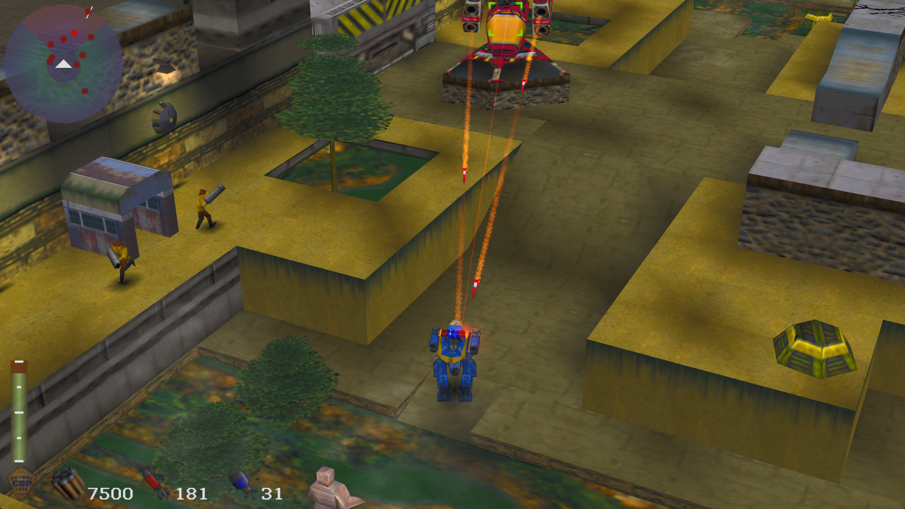
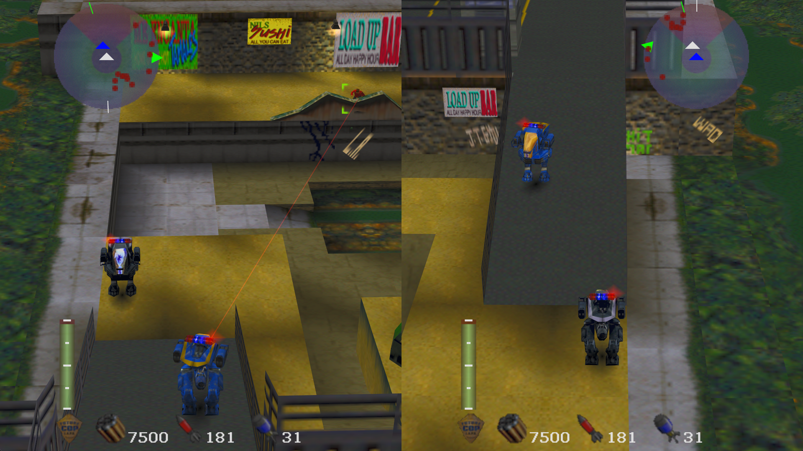
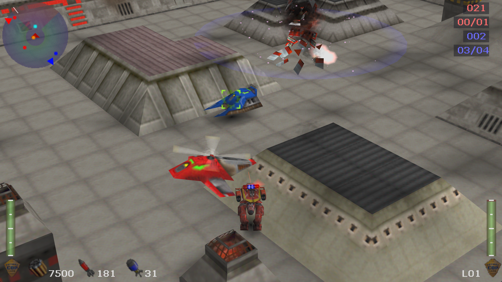
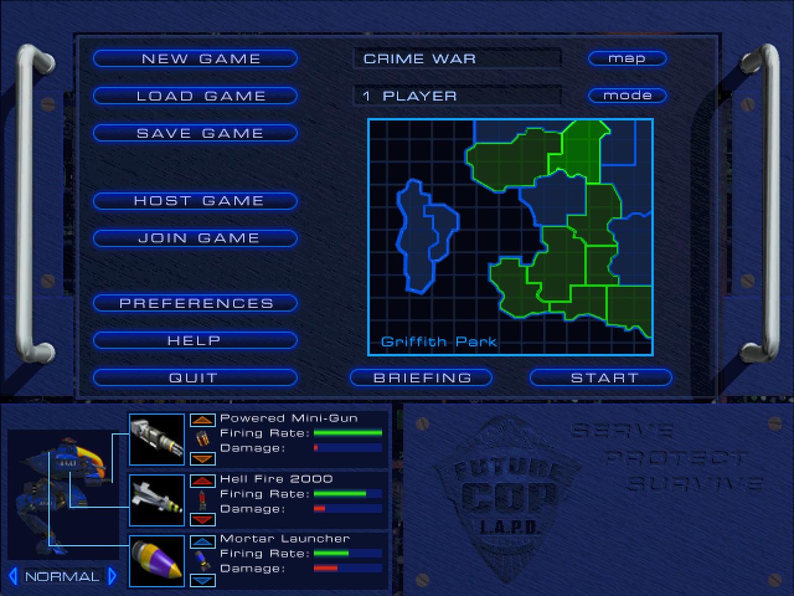

# future_rust_cop

A native port of **Future Cop: L.A.P.D.** (1998) in Rust. The game's own program is
recompiled: the player's `FCopLAPD.exe` is decoded with [iced-x86], every function is
lifted to [Cranelift] IR and compiled to native code when the game starts, and the
Windows/DirectX functions it calls are implemented in Rust (OpenGL for the 3D renderer, its
videos, sound, network play). No game code or data is part of this repository or its
releases: you need your own copy of the game.



<table>
  <tr>
    <td width="33%"></td>
    <td width="33%"></td>
    <td width="33%"></td>
  </tr>
  <tr>
    <td align="center"><em>Two players in split screen</em></td>
    <td align="center"><em>Precinct Assault</em></td>
    <td align="center"><em>The main menu</em></td>
  </tr>
</table>

## Playing

1. Download from the [releases]: `fcop-...-windows-x64.zip` for Windows or
   `fcop-...-linux-x64.tar.gz` for Linux (x86-64, OpenGL 3.3), and unpack it.
2. Put an image of your CD (`.iso` or `.bin`) next to `fcop.exe` (Linux: `fcop`), or copy your
   game into the `game_files` folder: the contents of the CD, an image of it, or your
   installed game folder.
3. Start `fcop.exe` (Linux: `./fcop` in its folder). It finds the game, checks the version,
   and keeps only what the game needs (`game_files/FCopLAPD`: FCopLAPD.exe, febmp.bin,
   missions; `game_files/Video`: the videos; taken out of a CD image); everything else in
   `game_files` goes to the recycle bin (Linux: it is deleted). The first start compiles the
   game (a second or two; kept in `game_files/FCopLAPD/compiled.bin`), later starts are quick.

Only the PC version's `FCopLAPD.exe` (SHA-256 `2dcdd1e7...7e5e`) is supported; with any other,
or without one, fcop says so. Its messages go to `fcop.log` next to it on Windows, to the
terminal on Linux. Settings go to `registry.txt`, key bindings to `controls.txt` and saves to
`save.cfg` in `game_files/FCopLAPD`. On Linux the libraries for sound (ALSA, or PipeWire/
PulseAudio through it) and gamepads (libudev) are needed; every desktop distribution has them.

What is new compared to the original:
- High resolution and widescreen (Hor+), fullscreen (Alt+Enter), anti-aliasing,
  texture filtering; all in the game's Preferences dialog
- Frame rates up to unlimited, with the game's logic unchanged
- Gamepads (up to two): choose the joystick profile in the Controller dialog. Left stick
  moves and turns proportionally in local games, RT gun, LT heavy weapon, A jump, B special,
  X action, Y change target, LB/RB jink,
  Back map, R3 camera, Start pause; the D-pad is free to bind
- Network play over TCP/IP (Host Game / Join Game; port 47624, type the host's address in
  the Join dialog)
- The arrow keys for player 1, and a camera close behind the robot
- Replacement textures (HD textures), see below

### Replacement textures

The game's textures are 256x256 pages (atlases of many small pictures). Each page, and each
part of one the game changes while it runs, is known by a hash of its contents. A PNG named
by that hash in `game_files/Textures` (or a folder below it; anything may come before the
hash, e.g. `street_0123456789abcdef.png`) replaces it: full colour, alpha for transparency
(soft edges are fine), up to 4 times the size (1024x1024 for a page). A replacement that is
the same as the original is left out.

To make them picture by picture, `fcop export` (in a terminal, in fcop's folder) cuts every
mission's pages into their pictures, found from what uses them: each model's part of a page
(the robot's upper body is one picture) and the terrain's (mostly a large part of a page;
the terrain takes windows anywhere in it). They go to
`game_files/Textures/pieces/<mission>_page<n>_<hash>/`, named after what uses them and where
they are (`M2C_model018_x1_y32_127x119.png`), with `layout.png` showing them on the page
(models magenta, terrain cyan) and `page.png`. Beside each picture a `.json` lists the faces
that show it: each corner's texture coordinates in the picture (0...1 from its top left
corner) and, for models, the corner's position on the model; for making it anew by hand or
with an AI given the picture and the file. Make new ones of the same name (larger is
fine, up to 4 times, transparent where nothing is to be drawn), then `fcop import` puts the
changed ones back into pages, `game_files/Textures/<mission>_page<n>_<hash>.png`: the game
uses them from its next start. `fcop export` keeps pieces that are already there.

`tools/texview` is a navigator for these folders (`cargo build --release` there; start
`texview` with the `pieces` folder, a page's folder or a piece, or drop one onto it): the
folders by mission on the left, the folder's pieces as thumbnails next to them, then the
selected piece, zoomable (mouse wheel, drag), with its faces drawn over it (UV grid; a face
under the mouse is lit, in the JSON too), the original beside it when it was changed, where it
lies on its page (a click there selects a piece) and its JSON. Changed pieces and folders are
marked orange; a piece saved by an image editor shows at once. Keys: Up/Down folder, Left/Right
piece, G grid, O original, E open in the editor, +/-/0 zoom, Ctrl+F filter.

Parts the game changes while it runs (the HUD's message icon) are only found by playing:
start fcop with `FCOP_DUMP_TEXTURES=1` set and every texture it has not seen before is
written to `game_files/Textures/dump` (transparent where the game leaves texels out).
`FCOP_HD=0` turns replacements off.

## Building

```
cargo build --release
cargo run --release -- path/to/FCopLAPD.exe
```

Without a path it sets up and uses `game_files` (next to fcop.exe, else in the current
folder) as above. `cargo test --release`
needs no game files. How it works and what is open: `CLAUDE.md` and `PLAN.md`.

[iced-x86]: https://github.com/icedland/iced
[Cranelift]: https://cranelift.dev
[releases]: https://github.com/RadiatorTwo/future_rust_cop/releases
